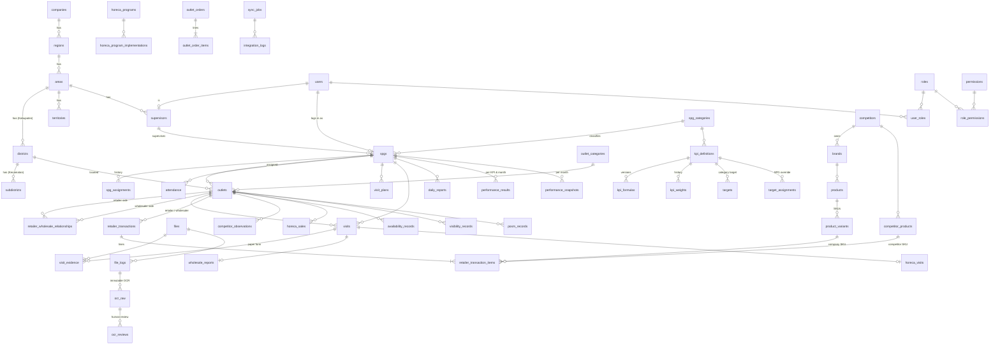

# Database design

PostgreSQL 16 is the **system of record** (Google Sheets is only an integration mirror). Schema source:
[`packages/database/prisma/schema.prisma`](../../packages/database/prisma/schema.prisma) · migrations in
`packages/database/prisma/migrations` (65 tables, 9 integrity triggers).

## Conventions

| Rule | Implementation |
|---|---|
| Identity | UUID (`gen_random_uuid` via Prisma `uuid()`) for every entity and transaction |
| Time | `timestamptz` in **UTC**; business dates (`work_date`, `period_month`, …) are `date` in **Asia/Jakarta** |
| Money / qty | `numeric(18,2)` / `numeric(14,3)` – never floating point |
| Offline writes | `client_id uuid UNIQUE` on every field record + `idempotency_keys` table |
| Concurrency | `version int` on mutable masters (optimistic locking) |
| History | effective-dated rows (`spg_assignments`, `outlet_assignment_history`, `kpi_formulas`, `kpi_weights`, `retailer_wholesale_relationships`), `is_current` on targets, `spg_employment_history`, append-only `audit_logs` |
| No deletion of facts | DB triggers block `DELETE` on transactions/orders/sales and any change to `audit_logs`, `ocr_raw`; approved transaction values are frozen (`tt_freeze_approved_tx`) |
| Data layers | `validation_status`: SUBMITTED (raw) → VALIDATED / NEEDS_REVIEW (automated) → APPROVED (human); REJECTED, SUPERSEDED (by correction), REVERSED |
| Data nature | `data_nature`: ACTUAL · ESTIMATE · OBSERVATION – sales KPIs use ACTUAL only |

## Core ERD

## Tables by domain

| Domain | Tables |
|---|---|
| Organization | companies, regions, areas, districts, subdistricts, territories, supervisors, spg_assignments |
| Users & RBAC | users, roles, permissions, user_roles, role_permissions, refresh_tokens |
| SPG | spg_categories, spgs, spg_employment_history |
| Master | outlet_categories, outlets (wholesalers, retailers, HORECA & regular outlets – ADR D1), outlet_assignment_history, retailer_wholesale_relationships, brands, products, product_variants, competitors, competitor_products |
| Field operations | attendance, visit_plans, visits, visit_evidence, daily_reports, activity_logs |
| SPG Grosir | wholesale_reports, retailer_transactions, retailer_transaction_items, competitor_observations (all channels – ADR D3), wholesale_observations |
| SPG HORECA | horeca_visits, horeca_sales, horeca_programs, horeca_program_implementations, posm_records (shared) |
| SPG Reguler | availability_records, visibility_records, posm_records, outlet_orders, outlet_order_items |
| KPI | kpi_definitions, kpi_formulas, kpi_weights, targets, target_assignments, performance_results, performance_snapshots |
| OCR & integration | files, file_logs, ocr_raw, ocr_reviews, sync_jobs, integration_logs |
| System | approvals, notifications, audit_logs, system_settings, idempotency_keys, data_quality_issues |

### Deviations from the brief's table list (documented decisions)

* `wholesalers` / `retailers` → unified `outlets` with `channel` (ADR D1) – same identity, GPS, assignment, history for all outlet types.
* `competitor_transactions` → competitor purchase lines are `retailer_transaction_items.product_owner = 'COMPETITOR'` (ADR D3) so company-vs-competitor share comes from one grain without double counting.
* `horeca_reports` / `regular_reports` → `daily_reports.content` validated by a **separate Zod schema per category**, plus channel-specific visit tables.
* `files` is mapped to the Prisma model `FileObject`; `file_logs` replaces the sheet-era FILE_LOG; `data_quality_issues`, `visit_plans`, `idempotency_keys`, `refresh_tokens`, `outlet_assignment_history` were added because the requirements need them.

## Key indexes & constraints (selection)

* `outlets_normalized_name_trgm_idx` (GIN, pg_trgm) – fuzzy duplicate detection.
* Partial unique: one active PRIMARY wholesaler per retailer; one current SPG assignment; one current KPI formula / weight; one current target per KPI-period (and per SPG override).
* CHECK: positive quantities, non-negative prices, company/competitor line consistency, facing totals (`company + competitor ≤ total`), lat/lng ranges, check-out ≥ check-in, KPI weight 0–100.
* Composite indexes on `(spg_id, date)`, `(outlet_id, date)`, `(validation_status, date)` for analytics.
